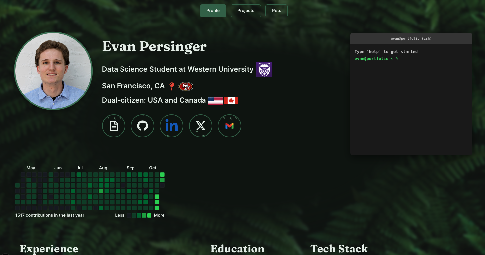

A personal portfolio website built with Next.js, React, and TypeScript.

## Tech Stack

- Next.js (App Router)
- React
- TypeScript
- CSS3
- pnpm (package manager)

## Features

- Profile, Projects and Pets pages
- GitHub activity calendar
- Interactive terminal (`ls`, `cd`, `cat`, `help`, and more) for navigating the site

## Getting Started

```bash
pnpm install
pnpm dev
```

Runs at http://localhost:3001. Use `pnpm build` and `pnpm start` for a production build.

## Deployment

Live at [portfolio-sable-seven-14.vercel.app](https://portfolio-sable-seven-14.vercel.app/), deployed on Vercel.

## Credits

Fern background photo by [Preethi Viswanathan](https://unsplash.com/@sallybrad2016) on [Unsplash](https://unsplash.com/).

## License

MIT
